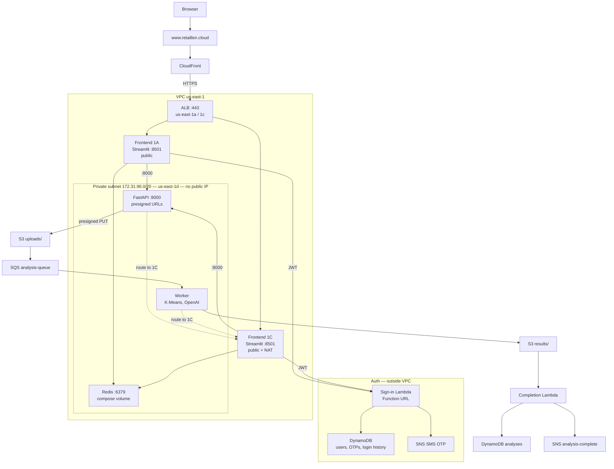
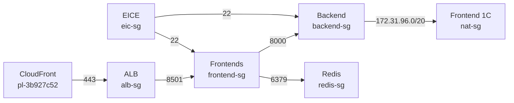
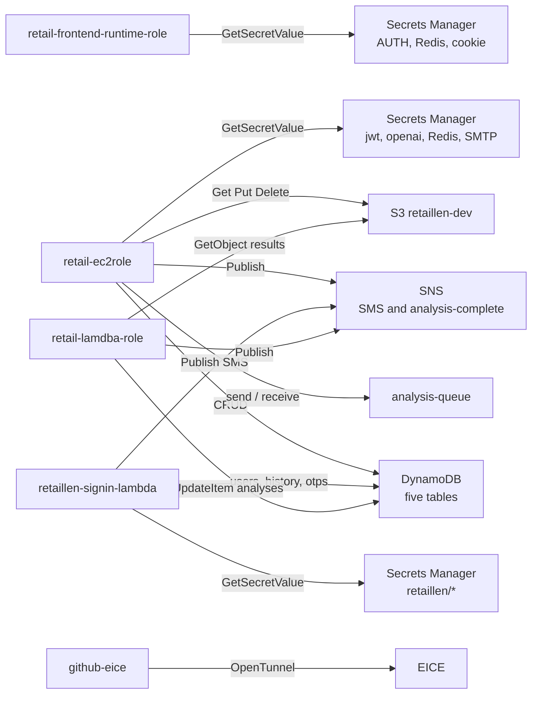

# Retail Lense

Secure multi-user cloud app for small retailers: RFM + K-Means customer segmentation, plus LLM-written advice. Built for COMPX527.

## Layout

```
frontend/     Streamlit UI (accounts, reference analysis, upload, reports)
backend/      FastAPI on EC2 + background workers + ML pipeline
infra/        IAM JSON, EICE/EC2 deploy scripts, systemd units,
              documentation CloudFormation (do not apply to the live account)
data/samples/ Tiny schema samples (not the full UCI dataset)
docs/         Architecture notes
```

Compute runs on **EC2**, plus an **auth Lambda** for sign-in and sign-up. Persistence is **DynamoDB + S3** (no RDS / SQL). Local auth still uses FastAPI when `AUTH_API_URL` is empty.

## Architecture

As deployed 25 September 2026, in the default VPC `vpc-0b7f1d790c744fbad` (`172.31.0.0/16`, `us-east-1`). Account `817817875692`. Demo: [www.retaillen.cloud](https://www.retaillen.cloud).



Browser traffic enters only through CloudFront, then the ALB in public subnets `us-east-1a` and `us-east-1c`. The ALB listener is HTTPS :443 (IAM certificate `cloudfront/retaillen-letsencrypt`, expires 24 November 2026; ACM is out of scope). It forwards to Streamlit on both frontends. Sign-in and sign-up go to a Lambda Function URL outside the VPC. Sessions live in Redis on the backend host, so a request that lands on the other frontend keeps the login.

The API, worker, and Redis run on one EC2 in `backend-private-subnet` (`172.31.96.0/20`, `us-east-1d`) with no public IPv4. That subnet has its own route table. `0.0.0.0/0` points at frontend 1C's ENI, not at an Internet Gateway and not at a NAT Gateway. On 1C, source/destination check is off and `iptables` MASQUERADE rewrites traffic from `172.31.96.0/20` to 1C's public address. `retaillen-nat-sg` accepts that subnet only, and only on 1C.

Uploads use a URL signed by the backend role. The browser writes the object to S3. S3 notifies `retaillen-analysis-queue`. The worker on the same host runs RFM and K-Means, writes `results/`, and a completion Lambda marks the job done and publishes `retaillen-analysis-complete`.

Address-level inbound, egress, and deploy diagrams are in [docs/architecture.md](docs/architecture.md). `infra/cloudformation/stack.yaml` is documentation of an older layout. Do not apply it to this account.

**In scope:** EC2, Lambda, ALB, CloudFront, S3, DynamoDB, SQS, SNS, Secrets Manager, CloudWatch, IAM, EICE.

**Forbidden by the brief, and not used:** RDS and any other relational database, SageMaker, Bedrock, WAF, ACM, Shield, Inspector, Redshift, QuickSight, Device Farm.

## Security

### Network

Security groups are the boundary. The live ALB group accepts TCP 443 only from the CloudFront origin-facing prefix list `pl-3b927c52`. That list is every CloudFront edge, so another distribution can still open the ALB; there is no secret origin header. WAF is forbidden, so rate limits are in the application (lockout, HTTP 429, CAPTCHA).

| Group | Inbound | Attached to |
| --- | --- | --- |
| `retaillen-alb-sg` | TCP 443 from `pl-3b927c52` | ALB |
| `retail-frontend-sg` | TCP 8501 from the ALB group | Both frontends |
| `retaillen-backend-sg` | TCP 8000 from the frontend group | Backend |
| `retaillen-redis-sg` | TCP 6379 from the frontend group | Backend (Redis on the same host) |
| `retaillen-nat-sg` | All from `172.31.96.0/20` | Frontend 1C only |
| `retaillen-ssh-sg` | TCP 22 from `retaillen-eic-sg` | All three EC2 |
| `retaillen-eic-sg` | none | EICE |

`retaillen-security-group` (TCP 22 from `0.0.0.0/0`) and `retaillen-app-sg` are leftovers. Neither is attached. Do not attach the SSH group.



Application security groups allow egress to `0.0.0.0/0`. That egress is how the instances reach Secrets Manager, AWS APIs, the Lambda URL, GitHub, OpenAI, and Gmail on port 587. Frontend 1A uses its own public address for that. The backend uses the 1C route above. 1A is not a second NAT.

### IAM

Instance and Lambda roles call AWS. Laptops do not hold production keys. Git JSON under `infra/iam/` is the policy text; the live backend role name is `retail-ec2role`.

| Principal | May call |
| --- | --- |
| `retail-frontend-runtime-role` (1A and 1C) | `GetSecretValue` on `retaillen/AUTH_API_URL`, `REDIS_URL`, `REDIS_PASSWORD`, `SESSION_COOKIE_PASSWORD` only |
| `retail-ec2role` (backend) | S3 get on `public/`, `uploads/`, `results/`; put and delete on `uploads/` and `results/`; DynamoDB CRUD on the five tables; SQS on `retaillen-analysis-queue`; `sns:Publish`; secrets `jwt`, `openai`, Redis, SMTP |
| `retaillen-signin-lambda` | DynamoDB on users, login-history, and otps; `sns:Publish` for SMS; `GetSecretValue` on `retaillen*` |
| `retail-lamdba-role` (completion) | `UpdateItem` on analyses, SNS on the completion topic, `s3:GetObject` on `results/*` |
| IAM user `github-eice` | `OpenTunnel` on the EICE endpoint, `SendSSHPublicKey`, describe instances in `us-east-1` |

The frontend role has no S3, DynamoDB, or SQS permission. The browser uploads with a presigned URL signed by `retail-ec2role`. The sign-in Lambda secret prefix `retaillen*` is wider than `retaillen/jwt` and should be tightened. `sns:Publish` on `*` is how SMS is authorized. `UploadServerCertificatePolicy` on the backend role is unused by the API. The frontend role also has the CloudWatch agent policy and `AmazonSSMManagedInstanceCore`; deploys themselves go through EICE, not SSM.



### Application controls

- Passwords are bcrypt. JWT material is `retaillen/jwt` in Secrets Manager (`JWT_SECRET` is a local fallback only).
- Five failed logins lock the account for 24 hours (HTTP 423). Repeated failures from one IP return 429. An account owner can block an IP (HTTP 403).
- Each attempt is stored in `retaillen-login-history` with the browser IP. Streamlit sends `x-retaillen-client-ip` because the Lambda URL's CloudFront hop rewrites `X-Forwarded-For`.
- SMS 2FA is optional after login. Unbound accounts sign in with a password only.
- Forgot-password emails a one-time link (48 h). Unknown addresses still return HTTP 200.
- DynamoDB user updates after login are attribute patches, so a sign-in cannot replace the row and drop `is_admin`.
- S3 keys are per-user prefixes. The UI does not list another user's prefix. Secrets are not in git. On EC2, `APP_ENV=aws` and empty secret env vars force a role read from Secrets Manager.
- IMDSv2 is required (hop limit 2) so Docker Compose can assume the instance role.

### Residual risks

1. **1C is a single egress hop.** Backend calls to S3, SQS, Secrets Manager, git, OpenAI, and SMTP stop if 1C stops or if Docker rewrites `iptables`.
2. **Frontends are on public subnets.** Port 8501 is limited by the frontend group today. Attaching `retaillen-security-group` would publish SSH.
3. **The sign-in Function URL is public HTTPS.** The control is bcrypt, JWT, and lockout. The URL itself has no IAM auth.
4. **Sign-in Lambda may read `retaillen*`.** The secret it needs is `retaillen/jwt`.
5. **The IAM certificate expires on 24 November 2026.**

## Python

Use **Python 3.12** (CI and Docker). `datetime.UTC` needs 3.11+. macOS Command Line Tools `python3` is often 3.9 and will fail.

```bash
python3.12 --version
# macOS if missing: brew install python@3.12
```

Create both venvs with that interpreter, not `/usr/bin/python3`:

```bash
cd backend && python3.12 -m venv .venv && .venv/bin/pip install -r requirements.txt
cd frontend && python3.12 -m venv .venv && .venv/bin/pip install -r requirements.txt
```

Do not run the API with `frontend/.venv` (Streamlit ships uvicorn, but the `api` package lives under `backend/`).

## Local run

Copy env once:

```bash
cp .env.example .env
```

| `.env` | User store |
| --- | --- |
| `APP_ENV=local` and empty `DDB_ENDPOINT` | In-memory (lost on API restart) |
| `DDB_ENDPOINT=http://127.0.0.1:8001` | DynamoDB Local |
| `APP_ENV=aws` and empty `DDB_ENDPOINT` | Real DynamoDB in `AWS_REGION` |

Restart the API after any `.env` change (`get_settings` is cached).

### Option A — two terminals (Python)

Terminal 1 — API (from the repo root):

```bash
./infra/scripts/run_api.sh
```

Equivalent:

```bash
cd backend
PYTHONPATH=. .venv/bin/uvicorn api.main:app --reload --port 8000
```

Terminal 2 — Streamlit UI:

```bash
cd frontend
export BACKEND_URL=http://localhost:8000
.venv/bin/streamlit run app.py
```

Windows (PowerShell), from the repo root. `py -3.12` is the Python launcher; venv tools live in `Scripts`, not `bin`.

```powershell
py -3.12 -m venv backend\.venv; backend\.venv\Scripts\pip install -r backend\requirements.txt
py -3.12 -m venv frontend\.venv; frontend\.venv\Scripts\pip install -r frontend\requirements.txt
copy .env.example .env
cd backend; $env:PYTHONPATH = "."; .\.venv\Scripts\uvicorn api.main:app --reload --port 8000
```

Second terminal: `cd frontend; $env:BACKEND_URL = "http://localhost:8000"; .\.venv\Scripts\streamlit run app.py`

### Option B — Docker

Skip the analysis worker for now (it is still a stub):

```bash
docker compose up --build frontend backend
```

### SMTP (password reset)

Forgot-password mail goes out through an external SMTP server. Restart the API after changing `.env`. An empty `SMTP_HOST` keeps mail in memory (what pytest uses) and does not send anything.

Gmail on port 587 with STARTTLS, which is what production uses:

```
BASE_URL=http://localhost:8501
SMTP_HOST=smtp.gmail.com
SMTP_PORT=587
SMTP_FROM_NAME=Retail Lense
SMTP_FROM_EMAIL=you@gmail.com
SMTP_AUTH_STRATEGY=TLS
SMTP_USER=you@gmail.com
SMTP_PASSWORD=app-password
```

`SMTP_AUTH_STRATEGY=SSL` connects with SMTPS instead of STARTTLS. `BASE_URL` is the front of the reset link (`/Reset_Password?token=...`). On EC2 set `BASE_URL=https://www.retaillen.cloud` and leave `SMTP_USER` and `SMTP_PASSWORD` empty so the backend reads `retaillen/SMTP_USER` and `retaillen/SMTP_PASSWORD` from Secrets Manager. Unknown addresses still return HTTP 200 and send nothing.

### URLs

- UI: http://localhost:8501
- API docs: http://localhost:8000/docs
- Health: http://localhost:8000/health

Sidebar pages: Home, Sign in (forgot-password expander), Sign up, Reset password, Account (profile + login history), Reference, Upload.

Auth API examples:

```bash
# register
curl -s http://localhost:8000/auth/register -H 'Content-Type: application/json' \
  -d '{"email":"a@example.com","username":"alice","full_name":"Alice","password":"password1","password_confirm":"password1"}'

# login (OAuth2 form: POST /auth/token). If SMS 2FA is on, this returns
# {"status":"otp_required","phone_hint":"..."} instead of access_token.
curl -s http://localhost:8000/auth/token -d 'username=alice&password=password1'

# optional SMS 2FA (bind after login; not required at sign-up)
curl -s http://localhost:8000/auth/2fa/phone -H "Authorization: Bearer TOKEN" \
  -H 'Content-Type: application/json' -d '{"phone":"+64211234567"}'
curl -s http://localhost:8000/auth/2fa/confirm -H "Authorization: Bearer TOKEN" \
  -H 'Content-Type: application/json' -d '{"code":"123456"}'
curl -s http://localhost:8000/auth/verify-otp -H 'Content-Type: application/json' \
  -d '{"username":"alice","code":"123456"}'
curl -s http://localhost:8000/auth/2fa/disable -H "Authorization: Bearer TOKEN"

# login history (Bearer token)
curl -s http://localhost:8000/auth/login-history -H "Authorization: Bearer TOKEN"

# block / list / unblock an IP for this account
curl -s http://localhost:8000/auth/blocked-ips -H "Authorization: Bearer TOKEN" \
  -H 'Content-Type: application/json' -d '{"ip":"203.0.113.9"}'
curl -s http://localhost:8000/auth/blocked-ips -H "Authorization: Bearer TOKEN"
curl -s -X DELETE http://localhost:8000/auth/blocked-ips -H "Authorization: Bearer TOKEN" \
  -H 'Content-Type: application/json' -d '{"ip":"203.0.113.9"}'

# forgot password (always 200; email exists or not)
curl -s http://localhost:8000/users/forgot-password -H 'Content-Type: application/json' \
  -d '{"email":"a@example.com"}'

# reset password (token from the email link)
curl -s http://localhost:8000/users/reset-password -H 'Content-Type: application/json' \
  -d '{"token":"TOKEN","email":"a@example.com","password":"password2","passwordConfirm":"password2"}'
```

Backend tests:

```bash
cd backend && PYTHONPATH=. pytest tests/
```

## DynamoDB (local or AWS)

Auth (users, login history, reset tokens) is stored in DynamoDB. Analyses/OTP tables are created now; the analysis workers still write stubs.

### Local — DynamoDB Local (no AWS account)

Users still need a database, or register and forgot-password vanish when the API restarts.

```bash
# 1. start the local DynamoDB (host port 8001 — 8000 is the API)
docker compose up -d dynamodb

# 2. point the API at it (repo-root .env)
#    DDB_ENDPOINT=http://127.0.0.1:8001
#    APP_ENV can stay local

# 3. create tables on that endpoint
./infra/scripts/create_dynamodb_tables.sh --yes

# 4. restart the backend, then check
curl -s http://localhost:8000/health
# expect: "store":"dynamodb","ddb_endpoint":"http://127.0.0.1:8001"
```

If **backend and DynamoDB both run in Compose**, the backend service already sets `DDB_ENDPOINT=http://dynamodb:8000`. Create tables from the host with `DDB_ENDPOINT=http://127.0.0.1:8001` (published port).

Stop later with `docker compose stop dynamodb`. Data lives in the `dynamodb-data` Docker volume.

### AWS account — real tables

Clear `DDB_ENDPOINT` and set `APP_ENV=aws`. Does not call STS. On-demand billing. Re-run is a no-op for tables that already exist.

```
APP_ENV=aws
AWS_REGION=us-east-1
DDB_ENDPOINT=
```

```bash
# preview
./infra/scripts/create_dynamodb_tables.sh --dry-run

# create missing tables (prompts for confirm)
./infra/scripts/create_dynamodb_tables.sh

# non-interactive
./infra/scripts/create_dynamodb_tables.sh --yes
```

Then restart the API and check:

```bash
curl -s http://localhost:8000/health
# expect: {"status":"ok","store":"dynamodb"}  — no ddb_endpoint
```

#### AWS credentials and `AWS_PROFILE`

Boto3 uses the default chain: env keys → `~/.aws/credentials` **`[default]`** → EC2 instance role.

If the machine has **several profiles** and `[default]` is the wrong IAM user, set the course profile in `.env`:

```
AWS_PROFILE=your-profile-name
```

List names with `aws configure list-profiles`. On a laptop, omit `AWS_PROFILE` when `[default]` is already the course account. On backend EC2 omit it entirely (do not write `AWS_PROFILE=`) so containers use instance role `retaillen-backend-runtime`. A blank value or a named profile that is not in the container is stripped and boto3 falls through to that role.

Do not put access keys in `.env`. A process-level `AWS_PROFILE=...` overrides `.env` (`setdefault`). Restart the API after changing it.

One-off for the table script: `AWS_PROFILE=your-profile AWS_REGION=us-east-1 ./infra/scripts/create_dynamodb_tables.sh --yes`

### Sign-in Lambda

No CloudFormation and no API Gateway. Deploy with the AWS CLI (or the console steps in `infra/scripts/deploy_signin_lambda.sh`). Farhan should attach `infra/iam/signin-lambda-deployer.json` if the current profile cannot create the function.

```bash
export AWS_PROFILE=mike-assume-infra AWS_REGION=us-east-1
./infra/scripts/deploy_signin_lambda.sh
```

Set `JWT_SECRET_NAME=retaillen/jwt` on Lambda and backend EC2. Their execution roles need `secretsmanager:GetSecretValue` for that secret; do not put the secret value in an AWS environment variable. On EC2 leave `AUTH_API_URL`, `REDIS_URL`, `REDIS_PASSWORD`, and `SESSION_COOKIE_PASSWORD` out of `.env` — Streamlit reads Secrets Manager `retaillen/<ENV_VAR>` via instance role `retaillen-frontend-runtime`. Locally keep those four values in `.env` so a laptop `AWS_PROFILE` never fetches production secrets. The same Lambda handles `POST /auth/signin` and `POST /auth/register`. Leave `AUTH_API_URL` empty locally so auth stays on FastAPI. The function uses role `retaillen-signin-lambda`, not `AWS_PROFILE`. `GET /auth/login-history` stays on FastAPI.

## Production (EC2, Ubuntu)

CloudFormation (`infra/cloudformation/stack.yaml`) documents the CLI-built layout and is **not** applied to this account. `infra/scripts/deploy.sh` exits without creating a stack. The SSH pipeline below is the **test environment**: a merge (push) to **`dev`** deploys the app. No SSM.

### One-time on the instance

Ubuntu as user `mike`. App dir: `/home/mike/retail-lense`.

```bash
sudo apt-get update
sudo apt-get install -y git python3.12 python3.12-venv

# Deploy key: GitHub repo → Settings → Deploy keys (read-only)
mkdir -p ~/.ssh
# put the private key in ~/.ssh/id_ed25519 (chmod 600)
ssh-keyscan github.com >> ~/.ssh/known_hosts

cd /home/mike/retail-lense
git checkout dev

python3.12 -m venv backend/.venv
backend/.venv/bin/pip install -r backend/requirements.txt
python3.12 -m venv frontend/.venv
frontend/.venv/bin/pip install -r frontend/requirements.txt

# Repo-root .env stays on the box only (APP_ENV=aws, empty DDB_ENDPOINT).
# Backend EC2 uses instance role retaillen-backend-runtime (no AWS_PROFILE).
# Frontend EC2: instance role retaillen-frontend-runtime only.
# edit .env: BASE_URL, SMTP, JWT_SECRET_NAME; omit AUTH_API_URL / Redis / cookie secrets.

sudo cp infra/systemd/retaillen-api.service infra/systemd/retaillen-ui.service /etc/systemd/system/
sudo systemctl daemon-reload
sudo systemctl enable --now retaillen-api retaillen-ui
curl -s http://127.0.0.1:8000/health
```

Give `mike` passwordless restart (once):

```bash
echo 'mike ALL=(root) NOPASSWD: /bin/systemctl restart retaillen-api, /bin/systemctl restart retaillen-ui, /bin/systemctl is-active retaillen-api, /bin/systemctl is-active retaillen-ui, /bin/systemctl status retaillen-api' | sudo tee /etc/sudoers.d/retaillen
sudo chmod 440 /etc/sudoers.d/retaillen
```

Allow GitHub Actions to reach the instances through the EC2 Instance Connect Endpoint (no public port 22). Attach `infra/iam/github-eice.json` to IAM user `github-eice` (the keys in `DEPLOY_AWS_*`).

### GitHub Actions secrets

| Secret | Example |
| --- | --- |
| `DEPLOY_HOST_BACKEND_US_1D` | Backend instance id in `us-east-1d` |
| `DEPLOY_HOST_FRONTEND_US_1A` | Frontend instance id in `us-east-1a` |
| `DEPLOY_HOST_FRONTEND_US_1C` | Frontend instance id in `us-east-1c` |
| `DEPLOY_EICE_ENDPOINT_ID` | One EICE id for backend and both frontend instances, e.g. `eice-05b0600db42072e83` |
| `DEPLOY_USER` | `mike` |
| `DEPLOY_AWS_ACCESS_KEY_ID` | IAM access key that can use Instance Connect Endpoint |
| `DEPLOY_AWS_SECRET_ACCESS_KEY` | Matching secret key |

A merge into **`dev`** (or a direct push to `dev`) runs tests, then deploys only the stack that changed: `backend/**` → backend EC2 in `US_1D`; `frontend/**` → **both** frontend instances (`US_1A` and `US_1C`) in parallel (each box `git fetch` + `git reset --hard origin/dev` + restart Streamlit). A `docker-compose.yml` change deploys backend and both frontends. Manual: Actions → CI/CD → Run workflow (deploys all). Production/`master` is not wired yet.

Backend and both frontend instances share `DEPLOY_EICE_ENDPOINT_ID`.

On a frontend-only instance, set `BACKEND_URL` in `.env` to the backend host or ALB (not `http://backend:8000`). Attach only `retaillen-frontend-runtime`. Omit `AUTH_API_URL` / `REDIS_URL` / `REDIS_PASSWORD` / `SESSION_COOKIE_PASSWORD` from `.env` so Streamlit reads `retaillen/<ENV_VAR>`. Compose does not pass `AWS_PROFILE` or access keys into the Streamlit container. The frontend deploy uses `docker compose up --no-deps` so it does not start the API on that box.

Port **80** needs root (or `setcap`). Better: Streamlit on 8501, ALB/nginx on 80.

Do not `docker compose up backend` if you want AWS DynamoDB — Compose sets `DDB_ENDPOINT=http://dynamodb:8000`.


## Dataset

Public reference analysis uses the [UCI Online Retail](https://archive.ics.uci.edu/dataset/352/online+retail) schema: `InvoiceNo`, `StockCode`, `Description`, `Quantity`, `InvoiceDate`, `UnitPrice`, `CustomerID`, `Country`.

## Conventions

All comments, docstrings, README/docs Markdown, and inline notes in this repository must be written in English.


ONLINE DEMO: www.retaillen.cloud


