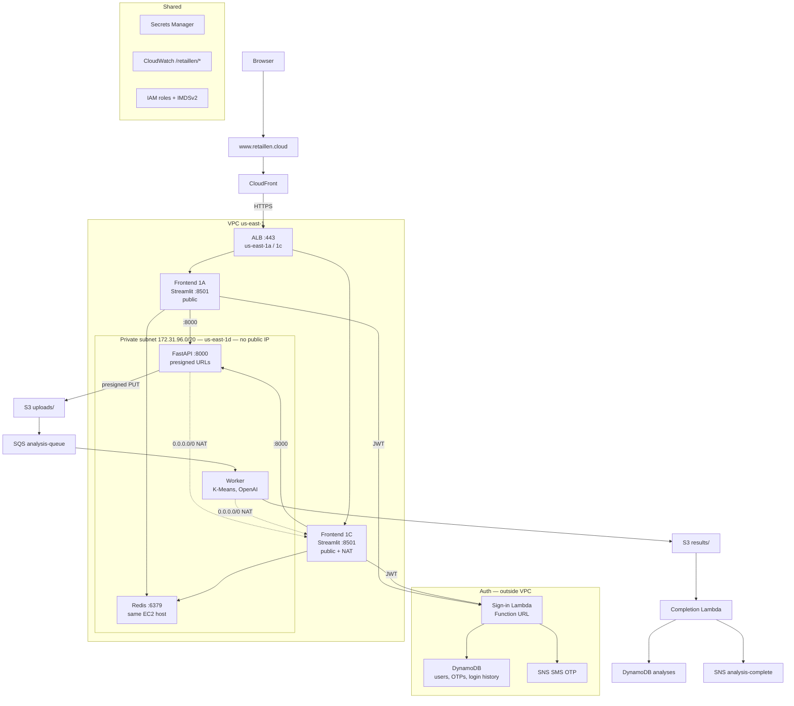
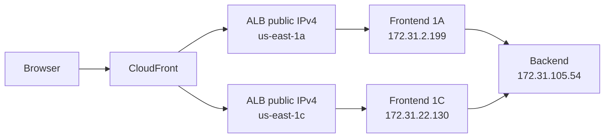
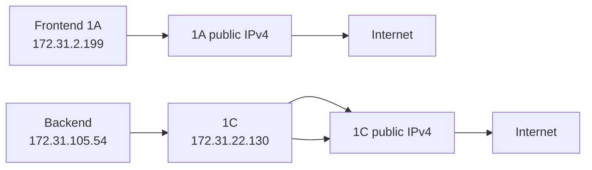
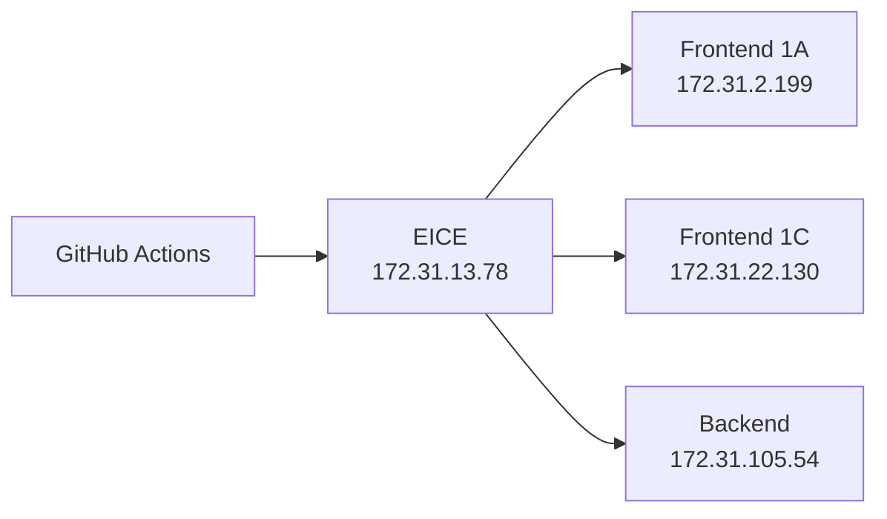

# Architecture

As deployed 25 September 2026. Backend is in a private subnet; IPv4 egress is instance NAT on frontend 1C (no NAT Gateway).

Compute is EC2 plus two Lambdas (sign-in Function URL; S3-triggered completion). Database is DynamoDB only. Secrets Manager holds secrets (not SSM).
No user groups: each account is a standalone user.
The Lambdas use execution roles (not IAM user `mike` / `AWS_PROFILE`).
SSH is EICE only; the private backend has no public IPv4.

## Address paths

Private addresses below were read from the instance ENIs on 25 September 2026. Public IPv4 on the ALB and on frontends 1A and 1C is auto-assigned, so those hops are named rather than numbered.

Inbound user traffic stops at the ALB public addresses, then uses private addresses only.

Outbound traffic leaves from 1A's own public address, and from 1C, which also NATs `172.31.96.0/20`.

Deploys do not use those public addresses. GitHub Actions enters through the Instance Connect endpoint, then SSH to the three private addresses.

